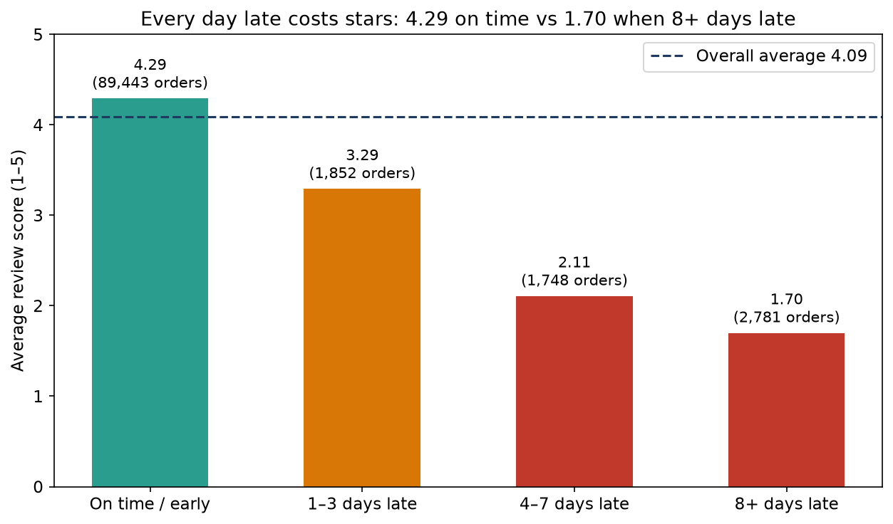

# Olist E-Commerce — Sales and Customer Behaviour

**One-line pitch:** Olist's marketplace did R$13.22M across 99,441 orders in two years — but late delivery turns a 4.29-star customer into a 2.27-star one, and freight eats 57% of every order under R$50.

**Business question:** Olist is a Brazilian marketplace connecting small sellers to large marketplaces. It has to decide which categories, sellers and regions to promote, where delivery and payment friction loses sales, and where review scores signal a fixable problem. Slow delivery and bad reviews lose repeat buyers; promoting the wrong categories wastes marketing spend; freight eats margin on low-value orders. This project answers those decisions with the marketplace's own order data.



## Key findings

- **Late delivery is the review killer.** On-time orders average **4.29 stars**; late orders average **2.27** — and **53.69% of late orders get 1 star, against 6.58% of on-time orders**. The damage scales with the delay: 1–3 days late averages 3.29, 4–7 days 2.11, 8+ days **1.70** (79.18% score 1–2). Overall the late rate is only **6.77%** (6,534 of 96,470 delivered orders with timestamps) — but those 6,534 orders are where the reputation damage concentrates.
- **Freight eats low-value orders.** Freight totals **R$2,198,276 — 16.63% of revenue**. On orders under R$50, freight averages **56.98% of the order value** (median 46.35%), and **44.96% of those orders pay freight worth half the order or more**. There are 28,791 such orders — 29.8% of all delivered orders. Above R$200, freight is 12.17% or less.
- **Growth was volume, not bigger baskets.** Delivered orders went from **750 in Jan 2017 (R$111,798) to 7,289 in Nov 2017 (R$987,765, the Black Friday peak)**, then settled at 6,100–7,000 a month in 2018. AOV stayed in a **R$124–152** band the whole time — the marketplace found more buyers, not more spend per buyer. Total delivered revenue is **R$13,221,498.11** at an AOV of **R$137.04** (median R$86.57).
- **Late delivery is a geography problem, not a category problem.** Maranhão's late rate is **17.43%** (21.5 days average delivery) and Ceará's **13.76%**, against **4.49% in São Paulo (8.7 days)**. Late rates by category are flat (4.3–8.1%), so this is logistics, not product. São Paulo is 41.98% of orders and 38.33% of revenue; SP + RJ + MG are 63.38% of revenue — and SP sellers supply 64.36% of item value, so the marketplace ships out of São Paulo to the rest of Brazil.
- **Almost nobody comes back.** **96.88% of the 96,096 unique customers ordered exactly once**; only 2,997 (3.12%) ordered twice or more, contributing just **5.75% of revenue** — and repeat buyers spend less per order (**R$124.67 vs R$137.88**). Credit card dominates payments (**76.94% of orders**), and installments scale with basket size: paid-in-full credit-card orders average R$82.27, 7–12 installments average **R$299.57**.

## Data source and size

- **Source:** Kaggle dataset "Brazilian E-Commerce Public Dataset by Olist" (`olistbr/brazilian-ecommerce`), 9 CSVs, downloaded 2026-11-21 from the public Kaggle endpoint `https://www.kaggle.com/api/v1/datasets/download/olistbr/brazilian-ecommerce` (44.7 MB zip, HTTP 200, no account needed).
- **Size:** 99,441 orders; 112,650 order items; 32,951 products; 3,095 sellers; 99,441 customers (96,096 unique); 103,886 payments; 99,224 reviews; 1,000,163 geolocation rows; 71 category translations. All counts verified on load (see notes/cleaning_notes.md).
- **Coverage:** Sep 2016–Oct 2018 (first purchase 2016-09-04, last delivered order purchased 2018-08-29; a handful of orders purchased in Sep–Oct 2018 were still in transit). 2016 is a ramp: only 267 delivered orders in the whole year, and zero orders in Nov 2016.

## Tools used

- **DuckDB** — loading and all analysis (SQL with CTEs, window functions, filtered aggregates)
- **SQL** — 30 queries across `sql/02_trend.sql` … `sql/08_customers_sellers.sql`
- **Python (pandas, matplotlib)** — EDA notebook and charts
- **HTML** — static dashboard (`dashboard/index.html`); spec for a Power BI / Tableau build in `dashboard/DASHBOARD_SPEC.md`

## Approach

1. **Load** the 9 CSVs into DuckDB (`sql/01_load.sql`, run via `python3 load.py`), parsing the timestamp columns and building one `order_level` table — one row per order with revenue, freight, item/seller counts, delivery dates and lateness — so revenue is never double-counted across an order's multiple items, payments or sellers.
2. **Define revenue once:** revenue = SUM(`price`) in order items, delivered orders only (96,478 of 99,441). `payment_value` is not revenue — it includes freight and is split across installments. Every decision is documented in `notes/cleaning_notes.md`, with QA checks in `load.py`.
3. **Analyse in SQL** — monthly/quarterly growth, revenue by category (English names via the translation table), by state and city, payment mix and installments, delivery performance (actual vs estimated date) by state/category/seller, freight as % of order value by price band, reviews by lateness bucket and category, repeat customers, seller concentration.
4. **Deduplicate reviews to one score per order** before averaging — 547 orders have more than one review row and `review_id` is reused across orders in the raw file, so averaging raw review rows would double-count orders.
5. **Visualize** — monthly revenue + orders, revenue by top 10 categories, AOV by payment type, late rate by state, review score by lateness, freight % by price band (`notebooks/01_eda.ipynb`, charts in `images/`).

## Recommendations

- **Fix delivery in the North-East first.** Maranhão (17.43% late, 21.5 days), Ceará (13.76%), Bahia (12.16%) and Rio de Janeiro (12.11%) are where late delivery is destroying reviews. Cutting Maranhão's late rate to São Paulo's 4.49% would move ~93 of its 717 orders from late to on time — and late orders are 53.69% 1-star.
- **Put a delivery promise you can keep on the product page.** The review penalty starts immediately: even 1–3 days late drops the average from 4.29 to 3.29. Promising the honest date and hitting it is worth more than promising a fast one and missing it — 8+ days late averages 1.70 stars.
- **Stop subsidising freight on sub-R$50 orders — or bundle them.** 28,791 delivered orders (29.8%) are under R$50 and pay freight worth 57% of the order on average. A free-shipping threshold above R$50, bundle prompts, or a minimum order value would cut the R$2.20M freight bill where it hurts most.
- **Promote health & beauty, watches & gifts and bed/bath — and high-ticket musical instruments and small appliances.** The top 5 categories are 39.83% of revenue, so the catalogue is broad; the AOV spread (R$61.60 electronics to R$301.66 musical instruments) is where marketing spend should follow margin, not just volume.
- **Protect the credit-card + installments funnel.** 76.94% of orders are credit card and installments scale with basket size (7–12 installments average R$299.57). Any friction in card checkout or installment options hits the biggest baskets hardest.
- **Treat retention as the growth lever, not acquisition.** 96.88% of customers never order twice. Roughly doubling the repeat share (3.12% → ~6%) at the current repeat AOV (R$124.67) would roughly double repeat revenue — about +R$760k at current scale — without buying a single new customer.

## Repository structure

```
olist-ecommerce-analysis/
├── README.md
├── load.py                # builds data/olist.duckdb from the 9 CSVs + QA checks
├── run_analysis.py        # runs sql/02–08, saves dashboard/*.csv
├── .gitignore
├── data/
│   ├── raw/               # the 9 Olist CSVs (git-ignored, 44.7 MB zip)
│   └── olist.duckdb       # built database (git-ignored)
├── sql/
│   ├── 01_load.sql        # raw loads + order_level (one row per order)
│   ├── 02_trend.sql       # monthly/quarterly trend, order status, KPIs
│   ├── 03_category.sql    # revenue/orders/AOV by category, concentration
│   ├── 04_geography.sql   # revenue/orders by state and city
│   ├── 05_payments.sql    # payment mix, AOV by type, installments
│   ├── 06_delivery.sql    # late rates by state/category/seller, freight %
│   ├── 07_reviews.sql     # review score by lateness bucket and category
│   └── 08_customers_sellers.sql  # repeat customers, seller concentration
├── notebooks/
│   ├── 01_eda.ipynb       # EDA with embedded charts and executed outputs
│   └── build_notebook.py  # regenerates the notebook + charts
├── dashboard/
│   ├── index.html         # static dashboard (open in a browser)
│   ├── DASHBOARD_SPEC.md  # Power BI / Tableau build spec
│   └── *.csv              # query outputs backing the dashboard
├── images/                # charts (monthly trend, categories, payments, lateness, freight, reviews)
└── notes/
    └── cleaning_notes.md  # every cleaning decision + QA results
```

## How to reproduce

```bash
git clone https://github.com/Saikrishna-469/olist-ecommerce-analysis.git
cd olist-ecommerce-analysis
pip install duckdb pandas matplotlib nbformat

# 1. Download the data (Kaggle "Brazilian E-Commerce Public Dataset by Olist", 44.7 MB)
mkdir -p data/raw
cd data/raw
curl -L -o olist.zip "https://www.kaggle.com/api/v1/datasets/download/olistbr/brazilian-ecommerce"
unzip olist.zip
cd ../..

# 2. Load into DuckDB (builds data/olist.duckdb, runs QA checks)
python3 load.py

# 3. Run the analysis (prints results, saves dashboard/*.csv)
python3 run_analysis.py

# 4. Rebuild the notebook and charts
python3 notebooks/build_notebook.py

# 5. Open the dashboard
open dashboard/index.html
```

## Limitations

- **Two years, one marketplace, Brazil only.** Volumes, freight costs and review behaviour are Olist's 2016–2018 reality. The *method* — order-level aggregation, promised-vs-actual delivery, review score by lateness bucket — transfers to any marketplace; the *levels* (6.77% late, R$137 AOV) do not.
- **Revenue is the item price, not what the buyer paid.** `payment_value` (which includes freight and installments) totals R$16.01M across all payment rows, against R$13.22M of delivered item revenue plus R$2.20M freight. The gap is mostly non-delivered orders that were still paid for, plus voucher/partial payments. Do not quote payment_value as revenue.
- **2016 is a ramp, not a baseline.** Only 267 delivered orders in 2016 and zero orders in Nov 2016 — the marketplace was launching. Year-on-year comparisons that include 2016 are meaningless; the trend analysis starts in Jan 2017.
- **Late delivery is measured against Olist's own estimate.** `late_days` is delivered date minus estimated date. If estimates were systematically padded in some states, the late rate understates the customer experience there — the absolute delivery time (e.g. 21.5 days in Maranhão vs 8.7 in São Paulo) is the check against that.
- **Review scores are analysed, not comment text.** 58,256 of 99,224 reviews (58.7%) have no comment message, and comment text is Portuguese. The score analysis is complete; the text would need translation and a separate sentiment pass.
- **Category revenue double-counts multi-category orders across categories.** An order with items in two categories contributes its items' revenue to each category. Category revenues sum to total delivered revenue at the item level, but "orders" per category overlap — a category's order count is orders containing that category, not exclusive orders.
- **No seller cost or margin data.** Freight is the buyer's freight charge, not Olist's logistics cost, and there is no product cost — so the freight and promotion recommendations are about revenue and customer experience, not profit. A margin-aware version needs seller cost data Olist does not publish.
